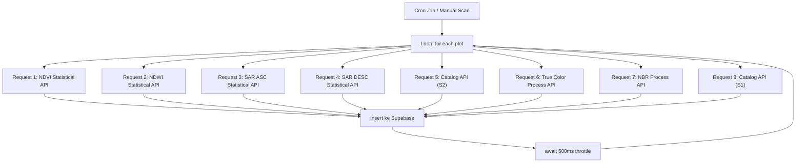
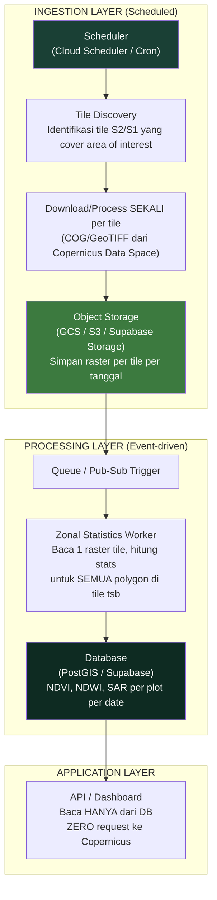

# 🛰️ SINAGRI Architecture Review: Satellite Data Pipeline

> Review Date: 18 Juli 2026  
> Scope: Efisiensi pengambilan data Copernicus, skalabilitas, dan kesiapan enterprise

---

## 1. Mekanisme Pengambilan Data Saat Ini

### Arsitektur: **Per-Polygon Request (N:N)**

Setelah saya mereview seluruh codebase, jawabannya **tegas**: **Setiap polygon melakukan request sendiri ke Copernicus.**

> [!CAUTION]
> Tidak ada tile-based processing, tidak ada caching layer, tidak ada batch grouping. Setiap polygon = 1 set request independen ke Sentinel Hub API.

#### Flow saat ini (per 1 polygon, per 1 scan harian):



#### Bukti dari kode:

| File | Bukti |
|---|---|
| [route.ts (cron)](file:///c:/Users/Ichan/Desktop/agrimrv/app/api/cron/satellite-scan/route.ts#L39) | `for (const plot of plots ?? [])` — loop sequential per plot |
| [ndvi.ts](file:///c:/Users/Ichan/Desktop/agrimrv/lib/sentinel-hub/ndvi.ts#L41-L44) | Request ke `sh.dataspace.copernicus.eu/api/v1/statistics` dengan geometry = **polygon tunggal** |
| [sar.ts](file:///c:/Users/Ichan/Desktop/agrimrv/lib/sentinel-hub/sar.ts#L40-L57) | 2 request terpisah (ASC + DESC) per polygon per scan |
| [truecolor.ts](file:///c:/Users/Ichan/Desktop/agrimrv/lib/sentinel-hub/truecolor.ts#L30) | Process API per polygon per scan |
| [cron route.ts L157](file:///c:/Users/Ichan/Desktop/agrimrv/app/api/cron/satellite-scan/route.ts#L157) | `await new Promise(r => setTimeout(r, 500))` — hardcoded 500ms delay antar plot |

#### Untuk Baseline (3 tahun):

| File | Bukti |
|---|---|
| [baseline/route.ts](file:///c:/Users/Ichan/Desktop/agrimrv/app/api/plots/%5BplotId%5D/baseline/route.ts#L127-L132) | 4 request paralel (NDVI + NDWI + NBR + SAR) tapi **hanya untuk 1 polygon** |

---

## 2. Jumlah Request Copernicus per Skenario

### Scan Harian (Cron Job)

Per polygon yang lolos interval check, cron melakukan:

| Tipe Request | Jumlah | API |
|---|---|---|
| NDVI | 1 | Statistical |
| NDWI | 1 | Statistical |
| Catalog S2 | 1 | Catalog |
| True Color | 1 | Process |
| SAR (ASC) | 1 | Statistical |
| SAR (DESC) | 1 | Statistical |
| Catalog S1 | ~1 per SAR pass | Catalog |
| **Total** | **~7 request** | |

### Baseline Pull (3 tahun, one-time)

| Tipe Request | Jumlah | API |
|---|---|---|
| NDVI (3yr) | 1 | Statistical |
| NDWI (3yr) | 1 | Statistical |
| NBR (3yr) | 1 | Statistical |
| SAR ASC (3yr) | 1 | Statistical |
| SAR DESC (3yr) | 1 | Statistical |
| **Total** | **5 request** | |

### Proyeksi Total Request

Asumsi: cron harian, rata-rata 50% polygon lolos interval check pada hari tertentu.

| Polygon | Cron/hari | Cron/bulan | Baseline (one-time) | Total Bulan Pertama |
|---|---|---|---|---|
| **100** | 350 | 10.500 | 500 | **11.000** |
| **1.000** | 3.500 | 105.000 | 5.000 | **110.000** |
| **10.000** | 35.000 | 1.050.000 | 50.000 | **1.100.000** |
| **100.000** | 350.000 | 10.500.000 | 500.000 | **11.000.000** |
| **1.000.000** | 3.500.000 | 105.000.000 | 5.000.000 | **110.000.000** |

> [!WARNING]
> **Copernicus Sentinel Hub Free Tier: 30.000 request/bulan.**  
> **Paid plans: bervariasi, namun 100 juta request/bulan akan sangat mahal.**
>
> Dengan arsitektur saat ini, SINAGRI akan **melebihi batas gratis pada ~430 polygon** saja.

---

## 3. Apakah Arsitektur Saat Ini Siap Scale?

### Jawaban singkat: **TIDAK.**

| Skenario | Verdict | Alasan |
|---|---|---|
| Subak Sangeh (5-20 plot) | ✅ Aman | Masih dalam batas gratis |
| Seluruh Bali (~50.000 petak sawah) | ❌ Tidak layak | ~17,5 juta req/bulan — mahal & lambat |
| Seluruh Indonesia (~8 juta petak) | ❌ Mustahil | ~2,8 miliar req/bulan — tidak realistis |
| Jutaan polygon | ❌ Mustahil | Bahkan platform EO besar tidak request per-polygon |

### Bottleneck Utama:

1. **Request per polygon** — Tidak ada tile deduplication; 100 polygon di area 1 km² = 100 request identik ke citra yang sama
2. **Sequential loop** — `for (const plot of plots)` dengan 500ms delay = 10.000 polygon butuh **83 menit**
3. **Vercel Serverless timeout** — Max 10 detik (free) atau 60 detik (pro) per request → cron akan timeout di ~120 polygon
4. **Tidak ada caching** — Data NDVI untuk tanggal yang sama diminta ulang jika ada 2 polygon di tile yang sama
5. **Tidak ada queue** — Tidak ada retry, tidak ada dead-letter, tidak ada backpressure

---

## 4. Arsitektur Ideal (Enterprise-Grade)

Visi Bapak **sudah tepat sekali**. Berikut arsitektur yang digunakan platform EO berskala besar:



### Prinsip Kunci:

| Prinsip | Penjelasan |
|---|---|
| **Tile-based ingestion** | Sentinel-2 membagi bumi dalam grid tile 100x100 km. Bali hanya butuh ~3-4 tile. Download raster tile SEKALI, lalu extract stats untuk ribuan polygon sekaligus. |
| **Process once, query many** | 1 raster tile = statistik untuk semua polygon yang berada di dalamnya |
| **DB-first dashboard** | Dashboard TIDAK PERNAH memanggil Copernicus. Semua data dibaca dari database. |
| **Event-driven processing** | Raster baru masuk → trigger worker → hitung zonal stats → simpan ke DB |
| **Idempotent & retry-safe** | Queue system menjamin setiap tile diproses tepat sekali |

---

## 5. Gap Analysis: SINAGRI Saat Ini vs Arsitektur Ideal

| Komponen | Ideal | SINAGRI Saat Ini | Status |
|---|---|---|---|
| Tile discovery | Identifikasi tile S2 yang cover AOI | ❌ Tidak ada | Missing |
| Tile-based download | Download raster sekali per tile | ❌ Per-polygon API call | **Critical gap** |
| Object storage (raster) | Simpan GeoTIFF/COG per tile | ❌ Tidak ada (hanya True Color PNG per plot) | Missing |
| Zonal statistics | Hitung NDVI/NDWI per polygon dari raster lokal | ❌ Minta Sentinel Hub hitung per polygon | **Critical gap** |
| Caching | Cache hasil per tile per tanggal | ❌ Tidak ada caching | Missing |
| Queue system | Bull/BullMQ, Cloud Tasks, Pub/Sub | ❌ Sequential for-loop | Missing |
| Batch processing | Proses ribuan polygon dari 1 tile | ❌ 1 polygon = 1 request | **Critical gap** |
| Dashboard reads DB only | ✅ Ya | ✅ Ya (setelah data masuk) | ✅ OK |
| Auth token caching | Cache token sampai expired | ✅ Ya ([auth.ts](file:///c:/Users/Ichan/Desktop/agrimrv/lib/sentinel-hub/auth.ts#L1-L9)) | ✅ OK |
| Adaptive scan interval | Kurangi scan saat fase stabil | ✅ Ya ([adaptive-scan.ts](file:///c:/Users/Ichan/Desktop/agrimrv/lib/adaptive-scan.ts)) | ✅ OK |

### Bagian yang masih melakukan request berulang:

1. **[cron/satellite-scan/route.ts](file:///c:/Users/Ichan/Desktop/agrimrv/app/api/cron/satellite-scan/route.ts#L39-L157)** — Loop `for (const plot of plots)` melakukan 7 request per plot
2. **[scan/route.ts](file:///c:/Users/Ichan/Desktop/agrimrv/app/api/plots/%5BplotId%5D/scan/route.ts#L141-L145)** — Manual scan: 3 Statistical + 1 Process + 1 Catalog = 6 request per klik
3. **[baseline/route.ts](file:///c:/Users/Ichan/Desktop/agrimrv/app/api/plots/%5BplotId%5D/baseline/route.ts#L127-L132)** — Baseline: 5 request per polygon (acceptable karena one-time)

---

## 6. Estimasi Resource per Skenario

### Asumsi:
- Scan interval rata-rata: 6 hari (50% polygon aktif per hari ÷ 6)
- Storage True Color PNG: ~50 KB/plot/scan
- SAR raster: ~20 KB/plot/scan (stats only, no image)
- DB row: ~1 KB/row

### Arsitektur SAAT INI (per-polygon):

| Metric | 1K polygon | 10K polygon | 100K polygon | 1M polygon |
|---|---|---|---|---|
| **Copernicus req/bulan** | 105.000 | 1.050.000 | 10.500.000 | 105.000.000 |
| **Processing time/hari** | ~8 min | ~83 min | ~14 jam | ❌ Impossible |
| **Bandwidth/bulan** | ~5 GB | ~50 GB | ~500 GB | ~5 TB |
| **Storage growth/bulan** | ~750 MB | ~7.5 GB | ~75 GB | ~750 GB |
| **DB rows growth/bulan** | ~150K | ~1.5M | ~15M | ~150M |
| **Est. Sentinel Hub cost** | ~€50 | ~€500 | ~€5.000 | ❌ Tidak feasible |

### Arsitektur IDEAL (tile-based):

| Metric | 1K polygon | 10K polygon | 100K polygon | 1M polygon |
|---|---|---|---|---|
| **Tile downloads/hari** | ~4 tiles | ~15 tiles | ~50 tiles | ~200 tiles |
| **Copernicus req/bulan** | ~120 | ~450 | ~1.500 | ~6.000 |
| **Processing time/hari** | ~2 min | ~5 min | ~15 min | ~45 min |
| **Bandwidth/bulan** | ~12 GB | ~45 GB | ~150 GB | ~600 GB |
| **Storage (raster)/bulan** | ~12 GB | ~45 GB | ~150 GB | ~600 GB |
| **DB rows growth/bulan** | ~150K | ~1.5M | ~15M | ~150M |
| **Est. cloud cost** | ~$30 | ~$100 | ~$400 | ~$1.500 |

> [!IMPORTANT]
> **Penghematan request Copernicus: 99.99%** pada 1 juta polygon.  
> Dari 105 juta request/bulan → 6.000 request/bulan.  
> Karena ratusan/ribuan polygon berbagi citra tile yang sama.

---

## 7. Rekomendasi Arsitektur Enterprise

Berdasarkan bagaimana platform seperti **Regrow (Indigo Ag)**, **Climate FieldView (Bayer)**, **Planet Insights**, dan **Descartes Labs** membangun pipeline mereka:

### Stack yang Direkomendasikan:

| Komponen | Rekomendasi | Alasan |
|---|---|---|
| **Data Source** | Copernicus Data Space Ecosystem (CDSE) — download langsung COG/GeoTIFF GRATIS | Bypass Sentinel Hub API quota sepenuhnya. CDSE menyediakan akses langsung ke archive Sentinel tanpa batas request. |
| **Tile Processing** | Cloud Function / Worker dengan `rasterio` + `rasterstats` (Python) | Baca COG langsung dari S3/GCS, hitung zonal stats untuk ribuan polygon sekaligus |
| **Queue System** | BullMQ (Node.js) atau Google Cloud Tasks | Pastikan setiap tile diproses tepat sekali, dengan retry |
| **Object Storage** | Supabase Storage / GCS / S3 | Simpan COG per tile per tanggal untuk reprocessing |
| **Cache Layer** | Redis atau Supabase (materialized view) | Cache hasil zonal stats agar dashboard instant |
| **Database** | PostGIS (Supabase) — sudah dipakai | Spatial query untuk identifikasi polygon-in-tile |
| **Scheduler** | Vercel Cron → trigger tile discovery → enqueue tiles | Hanya trigger, bukan processor |
| **Data Lake** | BigQuery / Parquet di GCS (opsional, untuk analytics) | Query historis jutaan row tanpa beban DB utama |

### Arsitektur Target (Phase-based Migration):

```
Phase 1 (Quick Win — minggu ini):
├── Batch polygon per Sentinel-2 tile grid
├── 1 Statistical API request per tile (bukan per polygon)
├── Parse response, distribute ke polygon
└── Estimasi penghematan: ~90% request reduction

Phase 2 (Medium Term — 1-2 bulan):
├── Download COG langsung dari CDSE (GRATIS, tanpa API quota)
├── Local zonal statistics dengan Python worker
├── Queue system (BullMQ)
└── Estimasi penghematan: ~99.99% Sentinel Hub cost

Phase 3 (Enterprise Scale — 3-6 bulan):
├── Event-driven pipeline (new tile available → auto process)
├── Data lake untuk analytics (BigQuery/Parquet)
├── Multi-region deployment
└── Real-time monitoring dashboard
```

---

## 8. Scorecard Pipeline SINAGRI Saat Ini

| Kriteria | Skor | Penjelasan |
|---|---|---|
| **Scalability** | **2/10** | Per-polygon request, sequential loop, Vercel serverless timeout — tidak bisa melampaui ~500 polygon |
| **Performance** | **4/10** | Parallel NDVI+NDWI OK untuk single plot, tapi cron sequential dengan 500ms delay sangat lambat |
| **Maintainability** | **6/10** | Kode bersih, terstruktur per-file, evalscript terdokumentasi. Tapi logika duplikat di 3 tempat (scan, baseline, cron) |
| **Cloud Cost** | **3/10** | Setiap polygon = 7 API calls × Copernicus pricing. Tidak sustainable di atas 1.000 polygon |
| **API Efficiency** | **2/10** | Tidak ada tile grouping, tidak ada caching, tidak ada deduplication. 100 polygon di area yang sama = 100× request identik |
| **Kesiapan Jutaan Polygon** | **1/10** | Arsitektur saat ini akan collapse jauh sebelum jutaan. Butuh redesign fundamental dari ingestion layer |

### Rata-rata: **3/10**

> [!NOTE]
> **Ini BUKAN kegagalan — ini evolusi alami.** SINAGRI dibangun sebagai Proof of Concept yang sangat berhasil. Arsitektur per-polygon sempurna untuk fase validasi (5-50 plot). Sekarang saatnya berevolusi ke arsitektur tile-based untuk fase scaling.
>
> Analoginya: Bapak sudah berhasil membuktikan bahwa mobilnya bisa jalan. Sekarang saatnya ganti mesinnya dari motor bebek ke turbo diesel agar bisa angkut truk kontainer.

---

## Ringkasan Eksekutif

| Pertanyaan | Jawaban |
|---|---|
| Apakah setiap polygon request sendiri? | **Ya, 100%.** |
| Apakah ada tile deduplication? | **Tidak.** |
| Bisa scale ke seluruh Bali? | **Tidak dengan arsitektur saat ini.** |
| Bisa scale ke seluruh Indonesia? | **Tidak mungkin tanpa redesign.** |
| Apa solusinya? | **Tile-based ingestion + zonal stats batch** |
| Berapa penghematan potensial? | **99.99% pengurangan API calls** |
| Apakah pendekatan Bapak (download → simpan → hitung batch) lebih efisien? | **Ya, sangat — itulah standar industri.** |
