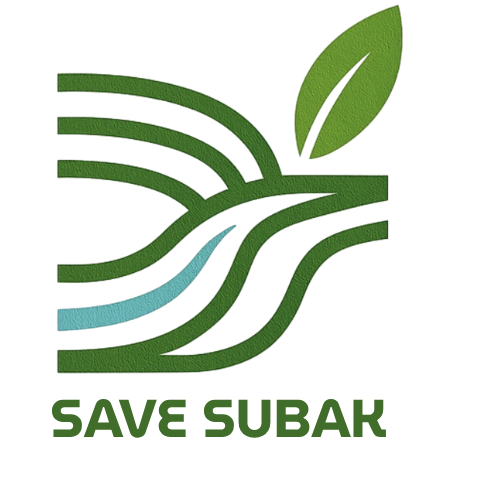

<div align="center">
  <h4 style="color:red;"><b>CONFIDENTIAL / RAHASIA</b></h4>
  <br><br><br>
  <!-- Tempat Logo Save Subak -->
  
  <br><br>
  <h1>Sinagri: Satellite Intelligence for Agricultural Resilience & Integrity</h1>
  <h3>Remote Sensing & Algoritma Verifikasi Karbon</h3>
  <br><br><br>
</div>

**Maksud & Tujuan:**
Dokumen ini disusun sebagai panduan teknis dan landasan ilmiah (*Scientific Blueprint*) bagi auditor dan pemangku kepentingan untuk memvalidasi algoritma pemantauan satelit pada sistem AgriMRV.

<br><br><br><br><br>
<div align="right">
  <p><b>Disusun Oleh:</b> Ichan Putra</p>
  <p><b>Tanggal:</b> 16 Juli 2026</p>
</div>

<div style="page-break-after: always;"></div>

---
*AgriMRV by Save Subak - Confidential*

## DAFTAR ISI
1. [Pendahuluan](#1-pendahuluan)
2. [Spesifikasi Satelit Pemantau](#2-spesifikasi-satelit-pemantau)
3. [Indeks Validasi Utama (Algoritma Optik)](#3-indeks-validasi-utama-algoritma-optik)
4. [Analogi Konseptual (Untuk Pemangku Kepentingan)](#4-analogi-konseptual-untuk-pemangku-kepentingan)
5. [Bukti Akurasi Sistem: Studi Kasus Fase Tanam](#5-bukti-akurasi-sistem-studi-kasus-fase-tanam)
6. [Lampiran Teknis: Algoritma & Kode JavaScript](#6-lampiran-teknis-algoritma--kode-javascript)

---
*Dibuat oleh: Ichan Putra*

<div style="page-break-after: always;"></div>

---
*AgriMRV by Save Subak - Confidential*

## 1. Pendahuluan
Platform **AgriMRV by Save Subak** memanfaatkan teknologi penginderaan jauh (*remote sensing*) terkini untuk melakukan *Measurement, Reporting, and Verification* (MRV) pada lahan pertanian sawah. Dokumen ini merangkum metodologi ilmiah yang kami gunakan, memastikan transparansi penuh bagi auditor karbon maupun pemangku kepentingan kelestarian lingkungan.

## 2. Spesifikasi Satelit Pemantau
Untuk memastikan keandalan data dalam segala kondisi cuaca, AgriMRV menggunakan pendekatan *multi-sensor* dari konstelasi satelit **Copernicus** milik **European Space Agency (ESA)**.

### A. Sentinel-2 (Satelit Optik Multispektral)
*   **Fungsi:** Bertindak sebagai "Kamera Raksasa" yang menangkap pantulan cahaya matahari (kasat mata maupun inframerah) dari permukaan bumi.
*   **Keunggulan:** Resolusi spasial hingga 10 meter, sangat tajam untuk memetakan petak-petak sawah.
*   **Interval Pengambilan (Revisit Time):** Melewati lokasi yang sama setiap **5 hari sekali**, memberikan data *time-series* yang sangat padat dan konsisten secara gratis.
*   **Penggunaan Utama:** Menghitung indeks NDVI, NDWI, dan NBR.

### B. Sentinel-1 (Satelit Radar / SAR)
*   **Fungsi:** Menggunakan teknologi *Synthetic Aperture Radar* (SAR) yang memancarkan gelombang mikro secara mandiri ke bumi dan menangkap gemanya. 
*   **Keunggulan Utama:** Gelombang mikro mampu **menembus awan tebal, kabut, dan hujan**, serta dapat beroperasi di malam hari. Sentinel-1 memancarkan gelombang secara Vertikal dan membaca pantulan secara Vertikal (VV) maupun Horizontal (VH).
*   **Penggunaan Utama:** Mengukur struktur fisik tanaman dari atas ke bawah (kanopi) dan tingkat kekasaran/kelembapan tanah permukaan, memastikan pemantauan tidak terputus di musim hujan.

---
*Dibuat oleh: Ichan Putra*

<div style="page-break-after: always;"></div>

---
*AgriMRV by Save Subak - Confidential*

## 3. Indeks Validasi Utama (Algoritma Optik)
Tiga indeks utama ini diekstraksi dari data mentah Sentinel-2 dan menjadi tulang punggung verifikasi di platform AgriMRV.

### 3.1. NDVI (Normalized Difference Vegetation Index)
*   **Penemu / Rujukan Ilmiah:** Rouse et al. (1974).
*   **Tujuan:** Mengukur tingkat kerapatan, kesehatan, dan biomassa tanaman (klorofil).
*   **Korelasi dengan Organik & Karbon:** Nilai NDVI yang konsisten tinggi menunjukkan keberhasilan penggunaan pupuk organik yang menyuburkan tanaman tanpa bahan kimia, sekaligus mengindikasikan tingginya penyerapan karbon (biomassa) oleh tanaman di lahan.

### 3.2. NDWI (Normalized Difference Water Index)
*   **Penemu / Rujukan Ilmiah:** McFeeters (1996).
*   **Tujuan:** Memisahkan fitur genangan air dari tanah kering dan vegetasi.
*   **Korelasi dengan Organik & Karbon:** Memverifikasi secara langsung kedisiplinan manajemen air di sawah (misalnya fase penggenangan awal dan pengeringan *Alternate Wetting and Drying* / AWD). Manajemen air yang tepat secara drastis mengurangi emisi gas metana (CH4) dari sawah.

### 3.3. NBR (Normalized Burn Ratio)
*   **Penemu / Rujukan Ilmiah:** Key & Benson (2006).
*   **Tujuan:** Mendeteksi area lahan yang terbakar dan mengukur tingkat keparahan api.
*   **Korelasi dengan Organik & Karbon:** Bukti absolut bahwa petani mematuhi protokol **Zero Burn** (tidak membakar jerami sisa panen). Jerami yang dibiarkan membusuk menjadi kompos karbon organik tanah, alih-alih menguap menjadi emisi karbon dioksida di udara.

---
*Dibuat oleh: Ichan Putra*

<div style="page-break-after: always;"></div>

---
*AgriMRV by Save Subak - Confidential*

## 4. Analogi Konseptual (Untuk Pemangku Kepentingan)
Bagi pembaca non-teknis, cara kerja satelit optik (Sentinel-2) dapat dipahami melalui analogi *"Paket dari Matahari"* berikut:

Bayangkan matahari menjatuhkan tiga "paket" ke bumi: **Bola Merah (Red)**, **Bola Hijau (Green)**, dan **Batu Panas Tak Terlihat (NIR - Inframerah Dekat)**. Tanaman sehat memiliki daun yang rakus memakan "Bola Merah" untuk berfotosintesis, namun daun tersebut juga bertindak sebagai perisai kuat yang menendang jauh "Batu Panas" agar tanaman tidak kepanasan. 

*   **Logika NDVI:** Satelit membandingkan seberapa banyak Batu Panas yang ditendang daun dikurangi sisa Bola Merah yang tidak dimakan. Semakin tinggi hasilnya, semakin subur tanaman tersebut.
*   **Logika NDWI:** Berbeda dengan daun, genangan air bertindak layaknya *Spons Hitam* yang menelan seluruh "Batu Panas" tanpa sisa. Namun, air masih memantulkan sedikit "Bola Hijau". Dengan mengurangkan pantulan Hijau dengan Inframerah yang tertelan, satelit dapat melihat air menyala kontras di tengah kegelapan tanah.
*   **Logika NBR:** Melibatkan "Sinar Oven Pencari Kekeringan" (SWIR / Inframerah Gelombang Pendek). Sinar ini diserap oleh air, namun akan memantul menyilaukan jika mengenai arang basah atau abu sisa pembakaran yang memiliki kelembapan 0%.

---
*Dibuat oleh: Ichan Putra*

<div style="page-break-after: always;"></div>

---
*AgriMRV by Save Subak - Confidential*

## 5. Bukti Akurasi Sistem: Studi Kasus Fase Tanam
Untuk membuktikan bahwa rumus yang digunakan bekerja sempurna di lapangan, perhatikan grafik fluktuasi NDVI dan NDWI di area persawahan berikut:


**Analisis Validasi (Mengapa Garis Bergerak Seperti Cermin?):**
Grafik yang saling berkebalikan secara persis (simetris) antara NDVI (Hijau) dan NDWI (Biru) adalah **bukti absolut** akurasi sistem untuk lahan sawah padi:
1.  **Fase Genangan (Awal Grafik - 26 Mei):** Sawah dibajak dan dipenuhi air. Air menelan gelombang NIR, menyebabkan **NDWI meroket tinggi**. Sebaliknya, karena belum ada daun hijau, **NDVI anjlok**.
2.  **Fase Vegetatif Rimbun (Tengah Grafik - 25 Jun):** Padi tumbuh lebat dan daunnya menutupi permukaan air. Daun memantulkan NIR secara masif. Akibatnya, **NDVI meroket tajam** ke atas. Karena genangan tertutup kanopi daun, satelit tidak mendeteksi air lagi, sehingga **NDWI anjlok** menjadi negatif.

Pola "cermin bersilangan" ini merupakan sidik jari (*fingerprint*) unik dari siklus tanam padi yang sehat.

---
*Dibuat oleh: Ichan Putra*

<div style="page-break-after: always;"></div>

---
*AgriMRV by Save Subak - Confidential*

## 6. Lampiran Teknis: Algoritma & Kode JavaScript
Bagian ini disediakan khusus bagi auditor teknis (Konsep *Whitebox*) guna memverifikasi bahwa perhitungan indeks dalam platform AgriMRV murni menggunakan rumus standar internasional tanpa manipulasi.

```javascript
/**
 * FUNGSI PERHITUNGAN INDEKS SATELIT (SENTINEL-2)
 * Platform: AgriMRV by Save Subak
 * 
 * Fungsi di bawah memproses raw pixel arrays dari citra multispektral.
 */

// 1. NDVI (Normalized Difference Vegetation Index)
// Band yang digunakan: B08 (NIR) dan B04 (Red)
export function calculateNDVI(nir, red) {
    // Mencegah error pembagian dengan nol pada piksel kosong (NoData)
    if (nir + red === 0) return 0; 
    return (nir - red) / (nir + red);
}

// 2. NDWI (Normalized Difference Water Index) - Metode McFeeters
// Band yang digunakan: B03 (Green) dan B08 (NIR)
export function calculateNDWI(green, nir) {
    if (green + nir === 0) return 0;
    return (green - nir) / (green + nir);
}

// 3. NBR (Normalized Burn Ratio)
// Band yang digunakan: B08 (NIR) dan B12 (SWIR2)
export function calculateNBR(nir, swir) {
    if (nir + swir === 0) return 0;
    return (nir - swir) / (nir + swir);
}

/**
 * Catatan Implementasi Tambahan:
 * Nilai dari fungsi di atas akan menghasilkan range antara -1.0 hingga +1.0.
 * Nilai ini kemudian dirata-rata (mean) secara spasial di dalam poligon (ROI) 
 * batas lahan untuk menghasilkan satu nilai indeks pada hari perekaman tertentu.
 */
```

---
*Dibuat oleh: Ichan Putra*


<div style="page-break-after: always;"></div>

---
*AgriMRV by Save Subak - Confidential*

## 7. Metodologi Kuantifikasi Karbon (Standar IPCC Tier 2)
Untuk merespons standar audit Verra VM0051 secara ketat, sistem AgriMRV menggunakan perhitungan konversi emisi Metana ke CO2e berdasarkan luasan absolut lahan.

**Formula Dasar:**
1. **Reduksi CH4 (kg) =** Total Hari Aerasi (Kering) � 1.2 kg CH4 � Luas Lahan (Hektar)
2. **Konversi ke Ton CO2e =** (Reduksi CH4 � 28 (GWP Metana)) / 1000

*Catatan: 1.2 kg CH4/ha/hari adalah faktor emisi pengeringan lahan (AWD) dari IPCC Tier 2. GWP (Global Warming Potential) Metana ditetapkan sebesar 28 untuk siklus 100 tahun.*

## 8. Ground Truthing (Bukti Fisik Lapangan) & Hysteresis
Kelemahan sensor satelit Radar (yang rentan terhadap embun atau noise angin) diatasi AgriMRV melalui 2 lapis filtrasi:

1. **Hysteresis Logika (Syarat 2 Titik):** Status genangan lahan tidak akan berubah di sistem hanya karena anomali 1 hari. Status 'Kering' baru tervalidasi jika satelit secara konsisten melihat kondisi kering pada minimal 2 kali jadwal *scan* berturut-turut.
2. **Pizometer (Pipa Pantau Air):** Meskipun satelit mengumpulkan data raksasa dari luar angkasa secara *Remote Sensing*, AgriMRV tetap mewajibkan **Ground Truthing**. Petani harus memasang Pipa Paralon berlubang (Pizometer) di sawahnya dan menginput ketinggian air tanah sesungguhnya ke dalam aplikasi sebagai kalibrator manual terhadap tebakan satelit.

## 9. Baseline Historis (3 Tahun / 36 Bulan)
Sebagai syarat mutlak dari Verra VM0051, AgriMRV melakukan ekstraksi data *Baseline* tidak hanya untuk 6 bulan, melainkan **3 Tahun Penuh (1095 Hari)** ke belakang sejak lahan diregistrasikan. Data satelit ditarik *on-demand* untuk membuktikan *Business as Usual* (BAU) bahwa petani tersebut memang terbiasa menggenangi sawahnya secara terus-menerus sebelum adanya intervensi pengeringan (AWD) dari Save Subak.

---
*Dibuat oleh: Ichan Putra*

